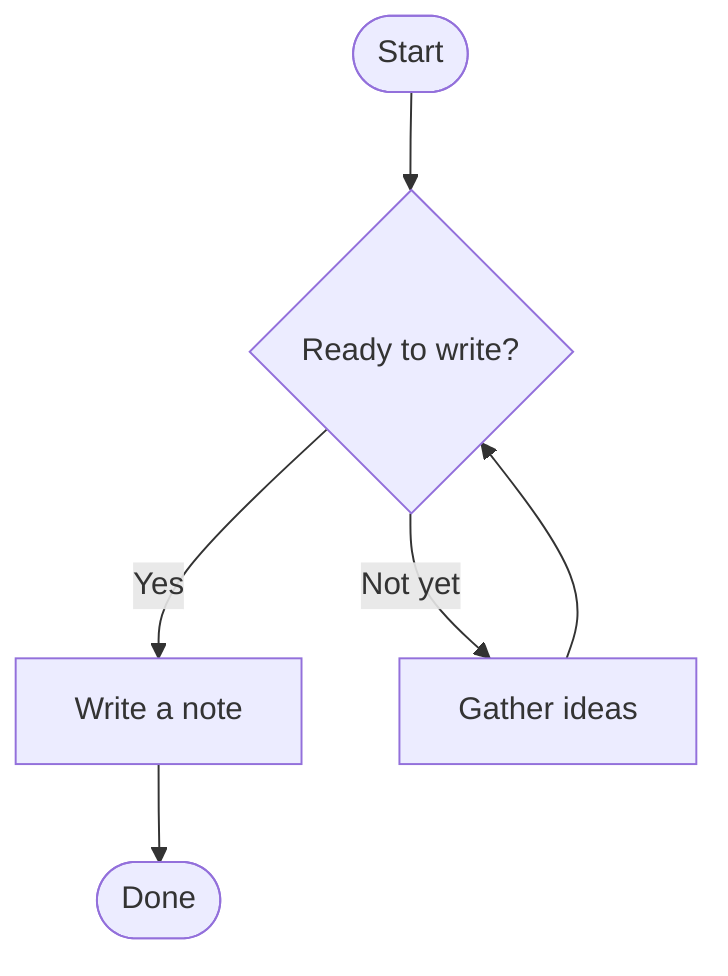
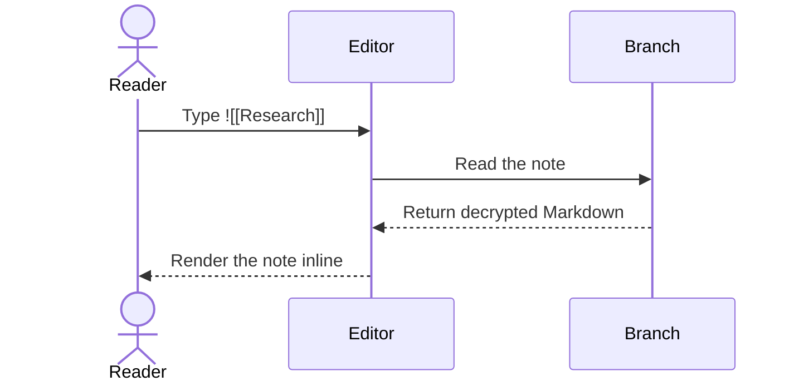
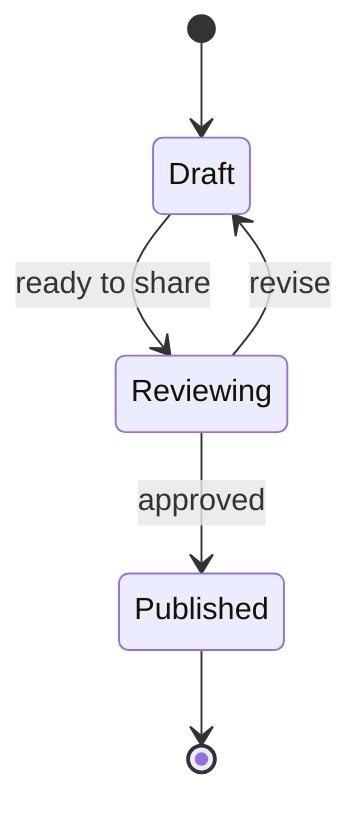
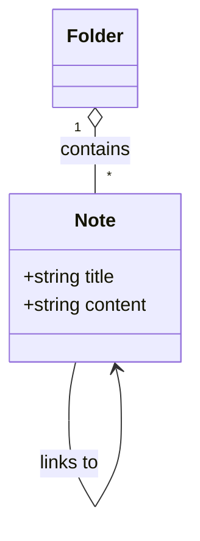
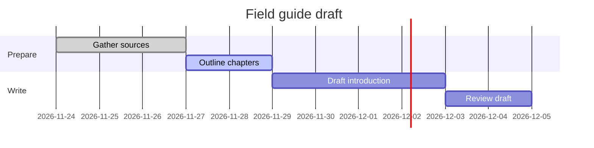
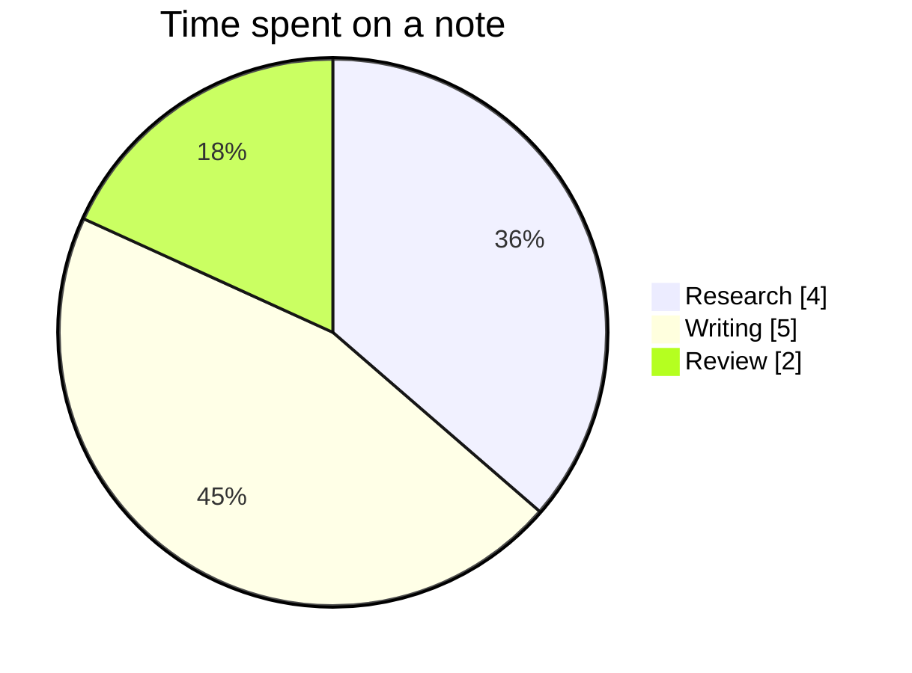
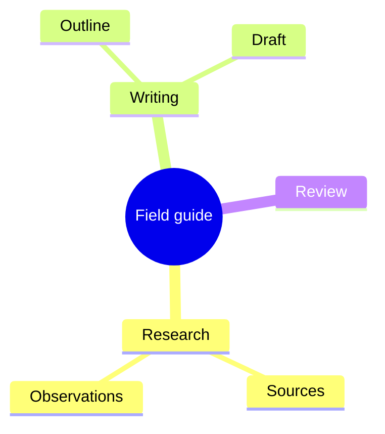

# Driftleaf Personalization Examples

Ready-to-use examples for personalizing Driftleaf: custom greeting lines, custom
CSS recipes, accent color ideas, and a reference of the CSS variables the app
exposes. Greetings live inside the branch; accent and custom CSS settings apply
globally across branches.

## Custom greeting lines

Set these in **Settings → Appearance → Welcome greeting**. One line is chosen
per day (a deterministic rotation based on the date, so it repeats on a cycle).
Rules: up to 20 lines, 160 characters each. The display name is shown separately
above the greeting as "Welcome back, <name>."

Driftleaf ships with four built-in lines:

- A fresh page is a small beginning.
- Take it one note at a time.
- Good ideas find their way here.
- Make room for what matters today.

Your custom lines rotate alongside the built-ins. **Tip**: because every line goes
into the same rotation pool, adding your favorite line more than once makes it
appear more often.

### Calm starters

- Slow is smooth, smooth is fast.
- Nothing here is urgent. It's just yours.
- Breathe first, write second.
- The page doesn't judge.
- One thought is enough for now.
- Start where your mind already is.

### Focus and momentum

- Pick the one thing that matters today.
- Start ugly, edit later.
- Ten focused minutes beat an unfocused hour.
- Finish the sentence you've been circling.
- Done beats perfect.
- What would make today feel complete?

### Cozy and playful

- Your second brain says hi.
- Thoughts, assemble.
- Somewhere in here is a great idea waiting.
- Warning: writing often leads to clarity.
- Tea optional but recommended.
- The notes missed you.

### Writer's craft

- The best note is the one you take.
- Capture now, organize later.
- Write like nobody's syncing.
- Your future self will thank you.
- Every expert was once a messy note-taker.
- A half-written note beats a perfect one in your head.

## Custom CSS

Custom CSS is set in **Settings → Appearance → Custom CSS** and applies across
branches. For privacy it runs under a few rules:

- Maximum 64 KB.
- `@import`, `url(...)`, `image-set(...)`, and backslash escapes are blocked,
  so no external fonts, images, or network requests.
- It is injected into the app UI, not into exported or printed notes.

Selectors occasionally change between versions, so treat these recipes as
starting points and keep your CSS small.

Custom CSS is applied after Driftleaf styles, including stylesheets loaded when
the editor opens. Theme-variable rules use low specificity, so a simple `:root`
override works; component rules should target the element you want to change.

### Markdown live preview

Inline math uses single dollar signs:

```text
The energy equation is $E = mc^2$.
```

Display math uses double dollar signs, either on one line or around a
multi-line expression:

```text
$$
\int_0^1 x^2 \, dx = \frac{1}{3}
$$
```

### Mermaid diagram examples

Put Mermaid syntax in a fenced block labeled `mermaid`. These examples cover
several diagram types supported by the live preview.

#### Flowchart

````markdown

````

#### Sequence diagram

````markdown

````

#### State diagram

````markdown

````

#### Class diagram

````markdown

````

#### Gantt chart

````markdown

````

#### Pie chart

````markdown

````

#### Mind map

````markdown

````

Embed another note with its title or folder-qualified path:

```text
![[Project Overview]]
![[Projects/Driftleaf]]
```

The embedded note's Markdown is sanitized before display. Images, active media,
and nested transclusions are omitted. Use **Focus** in the editor toolbar to
hide the sidebar and dim other lines. Enable **Typewriter scrolling** in
**Settings → Editor** to keep the current line centered while Focus mode is on.

### Variable reference

Driftleaf themes are built on CSS custom properties. Overriding them is usually
safer than restyling components. Theme palettes are applied via
`data-theme` on `:root` (`light`, `dark`, `aquatic`, `mossy`, `sunset`,
`space`, `cherry`, `arctic`, `amber`).

Custom CSS is applied after the accent theme rules and dynamically loaded editor
styles, so it can override both a theme palette and an accent selected in Settings.

| Variable | Purpose |
| --- | --- |
| `--ae-color-primary` | Buttons, active states, links |
| `--ae-color-primary-hover` / `-active` | Hover and pressed states |
| `--ae-color-primary-fg` | Text on primary-colored surfaces |
| `--ae-color-secondary` / `-hover` / `-fg` | Secondary buttons and surfaces |
| `--ae-color-bg` | App background |
| `--ae-color-surface` / `-hover` | Cards, panels, list hovers |
| `--ae-color-border` / `-focus` | Borders and focus rings |
| `--ae-color-text` / `-muted` / `-placeholder` | Text colors |
| `--ae-color-danger` / `success` / `warning` / `info` | Status colors |
| `--ae-font-sans` / `--ae-font-mono` | UI and code fonts |
| `--ae-space-1` … `--ae-space-4` | Spacing scale |
| `--ae-radius-sm` / `-md` | Corner rounding |
| `--code-comment`, `--code-keyword`, `--code-string`, `--code-number`, `--code-function`, `--code-type`, `--code-property`, `--code-meta`, `--code-inserted`, `--code-deleted` | Syntax highlighting colors |

Not every variable is defined by every palette. When overriding, provide a
fallback: `var(--ae-color-primary, #4f7a5c)`.

### Recipe: serif reading font

```css
.editor__codemirror .cm-editor .cm-content {
  font-family: Georgia, "Times New Roman", serif;
  line-height: 1.7;
}
```

### Recipe: narrower writing column

Keeps long lines comfortable on wide monitors.

```css
.editor__codemirror .cm-editor .cm-content {
  max-width: 42em;
  margin-inline: auto;
}
```

### Recipe: hide note snippets in the sidebar

Shows only titles in the note list.

```css
.sidebar__snippet {
  display: none;
}
```

### Recipe: softer, rounder chrome

```css
.ae-modal,
.canvas-card,
.update-banner {
  border-radius: 18px;
}
```

### Recipe: a bigger, calmer welcome screen

```css
.main__welcome h1 {
  font-size: 2em;
  font-weight: 600;
}

.main__welcome p {
  font-size: 1.1em;
  opacity: 0.85;
}
```

### Recipe: per-theme accent override

The accent color picker is the easy path for a single accent. Use CSS when you
want a different accent per theme. Hover and active states are darker mixes of
the primary, and `--ae-color-primary-fg` must contrast with it.

```css
:root[data-theme="amber"] {
  --ae-color-primary: #d98e2b;
  --ae-color-primary-hover: #c47f24;
  --ae-color-primary-active: #a96d1e;
  --ae-color-primary-fg: #1c1305;
  --ae-color-border-focus: #d98e2b;
}
```

### Recipe: warmer syntax colors

```css
:root {
  --code-string: #b5651d;
  --code-function: #2e6f95;
  --code-keyword: #8a4fb8;
}
```

### Recipe: quieter banners

The update and announcement banners float at the top of the window.

```css
.update-banner,
.announcement-banner {
  box-shadow: none;
  opacity: 0.95;
}
```

## Accent color presets

Pick these in **Settings → Appearance → Accent color**. Six-digit hex only.
Mid-tone colors work best because the accent is used for button fills and text
highlights in both light and dark themes.

| Name | Hex | Pairs well with |
| --- | --- | --- |
| Forest | `#2f9e6e` | Light, Mossy |
| Indigo | `#6e7fd1` | Dark, Space |
| Rosewood | `#c95f7f` | Cherry, Sunset |
| Teal | `#2f9ea8` | Aquatic, Arctic |
| Honey | `#c9973a` | Amber |
| Graphite | `#7a8492` | Any theme, understated |

After picking an accent, Driftleaf derives hover, active, and foreground colors
automatically and adjusts text contrast for you.

## Greeting combos to try

A display name changes the headline above the daily greeting.

- Display name `Aster` renders: "Welcome back, Aster." followed by the day's line.
- Leaving the name empty renders: "Welcome back."

Ideas that read well as pairs (headline + line):

- `Captain` + "What's on the agenda, first mate?" (playful)
- `Me` + "The page doesn't judge." (reassuring)
- No name at all + "Take it one note at a time." (quiet and default)
